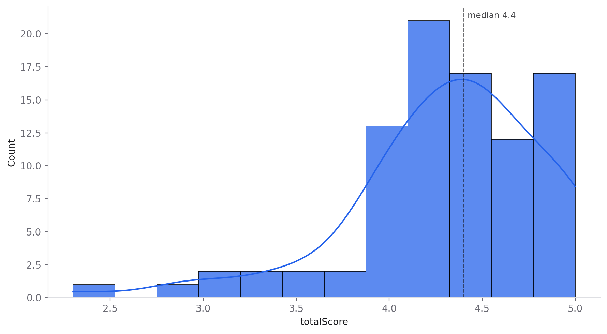
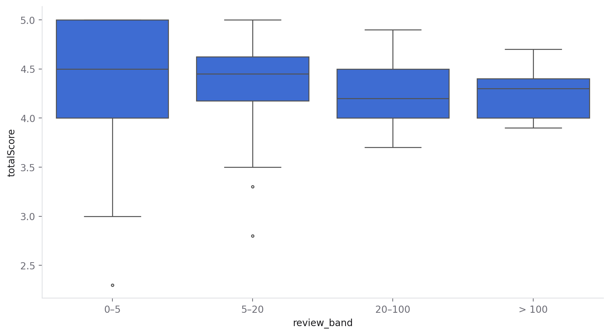
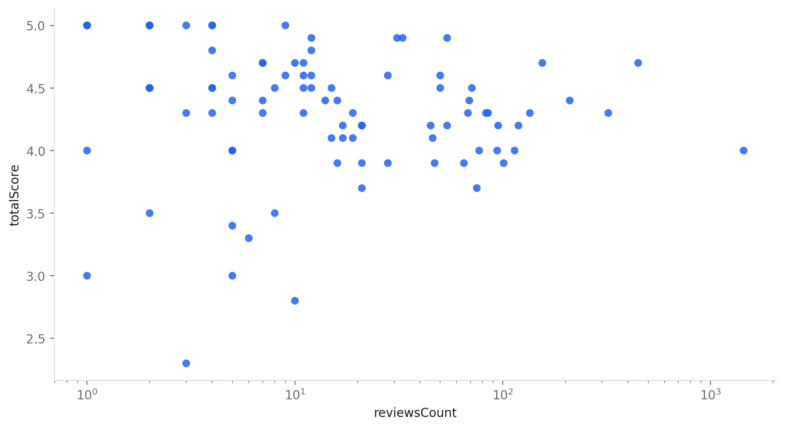

# What makes a top-rated gym in Baghdad?

*A Data Boss case study: data-quality checks, cleaning, statistical tests and a fairer ranking, all done in the app and exported as a notebook, a script and a report.*

**Short answer:** nothing in the listings themselves (website, phone, category) clearly goes with a better rating. What matters most is **how many reviews stand behind the rating**: the "perfect 5.0" gyms are almost all rated by a handful of people. A trust-adjusted rating gives a much more useful top 10.

| Files | |
|---|---|
| [`report.pdf`](report.pdf) / [`report.html`](report.html) | The report exported from Data Boss |
| [`baghdad_gyms_session.ipynb`](baghdad_gyms_session.ipynb) | The whole session as a Jupyter notebook (every cleaning step and chart) |
| [`baghdad_gyms_cleaning.py`](baghdad_gyms_cleaning.py) | The cleaning steps as a pandas script |
| [`figures/`](figures) | Charts exported from Data Boss |

## The data

100 gyms in Baghdad scraped from Google Maps listings: name, rating (`totalScore`, 1–5), number of reviews, address, website, phone and Google category. The raw file is not published here; the notebook and script run next to your own copy (`Baghdad_gym_dataset.csv`).

## 1. Checking quality first

Data Boss's **Inspect › Overview** flagged twelve issues before any analysis:

- **`state` and `countryCode` hold a single value** (Baghdad Governorate, IQ), so they carry no information.
- **10 gyms have no rating and no review count.** They can't answer a question about ratings.
- **`website` is 77% missing and `phone` 56% missing.** Missing here is information in itself (the gym doesn't list one), so these became yes/no flags instead of being filled.
- **`categories/1` and `categories/2` are almost empty**, and `categoryName` repeats `categories/0`.
- **One `city` value is a district name, `الكمالية،` (Kamaliya),** instead of Baghdad.
- **`reviewsCount` is heavily skewed:** median 12, but one gym has 1,441.

## 2. Cleaning (every step undoable, exported as code)

1. Dropped the five empty or constant columns.
2. Replaced `الكمالية،` with `Baghdad` in `city` (Kamaliya is in Baghdad).
3. Dropped the 10 gyms without a rating, leaving **90 gyms**.
4. Added `has_website`, `has_phone` and `site_type` (none / social page / own website) with **Calculated column**.
5. Grouped `reviewsCount` into `review_band` (0–5, 5–20, 20–100, > 100) with **Bin into ranges**.
6. Added a **trust-adjusted rating** (see section 4).

## 3. What goes with a higher rating?



Ratings cluster high: the **median is 4.4**, half of all gyms sit between 4.0 and 4.7, and a few low scores make a long left tail. With so little room at the top, small differences in rating mean little.

I tested every candidate with **Analyze › Tests**, which picks the test from the data's shape and reports the effect size alongside the p-value:

| Question | Test chosen | Result |
|---|---|---|
| Do gyms with a website rate higher? | Mann-Whitney U | No clear difference (p = 0.86, rank-biserial r = −0.03) |
| Own website vs social page vs none? | One-way ANOVA | No clear difference (p = 0.12). The 7 gyms with their own website average 4.69, too few to be sure. |
| Do gyms that list a phone rate higher? | Student's t-test | No clear difference (p = 0.11). Gyms *without* a phone average 0.18 higher, 95% CI −0.04 to +0.40. |
| Does the number of reviews matter? | Spearman correlation | **Yes, weakly: more reviews goes with a slightly lower rating** (ρ = −0.27, p = 0.01, 95% CI −0.45 to −0.07) |

**Inspect › Target** agreed: website, phone and category explain almost none of the variation in rating. (Running this exposed a bug: phone numbers, unique per gym, were reported as "explaining 100%" of the rating. It's [fixed](https://github.com/49mg/data-boss/commit/e091d4a): nearly unique columns are now skipped instead of looking "very strong".)

## 4. The real story: ratings from a handful of reviews are noise



| Reviews | Gyms | Mean rating | Lowest | Highest |
|---|---|---|---|---|
| 0–5 | 28 | 4.36 | 2.3 | 5.0 |
| 5–20 | 28 | 4.34 | 2.8 | 5.0 |
| 20–100 | 25 | 4.25 | 3.7 | 4.9 |
| > 100 | 9 | 4.28 | 3.9 | 4.7 |

The **average** barely changes (Kruskal-Wallis p = 0.15), but the **spread** collapses: gyms with five reviews or fewer range from 2.3 to 5.0, while gyms with more than 100 reviews all sit between 3.9 and 4.7. All 11 gyms rated 5.0 have **9 reviews or fewer**.



That's the expected statistical pattern: an average of three ratings jumps around, an average of three hundred doesn't. Ranking by raw rating rewards luck.

### A fairer ranking

A **trust-adjusted rating** (a Bayesian average) pulls each gym toward the overall average (4.31) in proportion to how few reviews it has. The weight of 12 "virtual" reviews is the median review count:

```
adjusted = (rating × reviews + 4.31 × 12) / (reviews + 12)
```

It's one **Calculated column** in Data Boss. The two top 10s look very different:

| By raw rating | Rating | Reviews | | By adjusted rating | Rating | Reviews | Adjusted |
|---|---|---|---|---|---|---|---|
| GOLDEN GYM | 5.0 | 9 | | **WOLF GYM** | 4.9 | 54 | 4.79 |
| ADAM GYM | 5.0 | 4 | | LUNA by wolf - Karrada | 4.9 | 33 | 4.74 |
| The leader gym | 5.0 | 4 | | F45 Training Karada | 4.9 | 31 | 4.74 |
| بارك جم _ Park gym | 5.0 | 3 | | Wolf Gym | 4.7 | 448 | 4.69 |
| Power fitness | 5.0 | 2 | | Power Gym | 4.7 | 155 | 4.67 |
| Olimp gym | 5.0 | 2 | | GOLDEN GYM | 5.0 | 9 | 4.61 |
| Bear Gym | 5.0 | 2 | | Power GYM | 4.9 | 12 | 4.61 |
| Lamer Gym | 5.0 | 2 | | Royal Gym | 4.8 | 12 | 4.56 |
| Al-Haddad gym | 5.0 | 1 | | Snap GYM | 4.6 | 50 | 4.54 |
| جم واو WoW Gym | 5.0 | 1 | | MR. Olympia GYM | 4.6 | 28 | 4.51 |

Names are as listed on Google Maps; the two "Wolf" rows are separate listings.

The adjusted list is led by gyms that keep high ratings across dozens or hundreds of reviews. All of the top four carry the **Wolf** name or are in **Karrada**. The raw list is led by gyms nobody can judge yet.

**Analyze › Compare segment** on the gyms with five reviews or fewer found one more clear difference: only **21% of them list a phone number**, against 56% of the rest. These look like newer or smaller gyms with thinner listings, not "better" ones.

## Conclusions

1. **Don't rank by raw star rating.** In this data a 5.0 means "few reviews", not "best gym". A trust-adjusted rating is a one-line fix.
2. **Listing details don't predict quality.** Having a website, a phone number or a particular category shows no clear link to rating.
3. **A gym that wants a credible rating needs volume.** The consistently high-rated gyms are the ones with many reviews.

## Limitations

- **Small sample:** 90 gyms with ratings. Several tests are underpowered; "no clear difference" means this data can't tell, not that there is no difference.
- **One snapshot of Google Maps:** no dates, so no trends; reviews can be uneven or incentivised.
- **The adjusted rating is a judgement call:** the prior weight of 12 is a reasonable default (the median review count), not a law. Other weights reorder the middle of the list, but not the overall picture.
- **Observational data:** nothing here shows what *causes* a good rating.

*Made with [Data Boss](../../README.md). Every number above comes from the exported notebook and script in this folder.*
