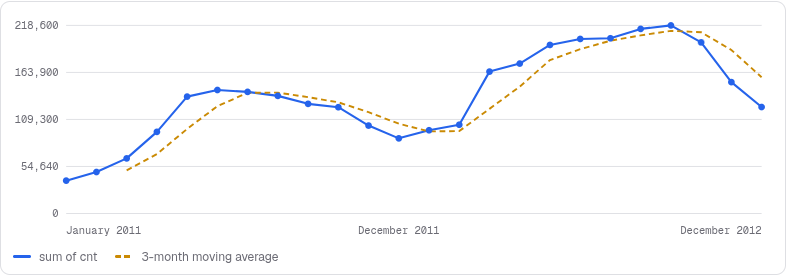
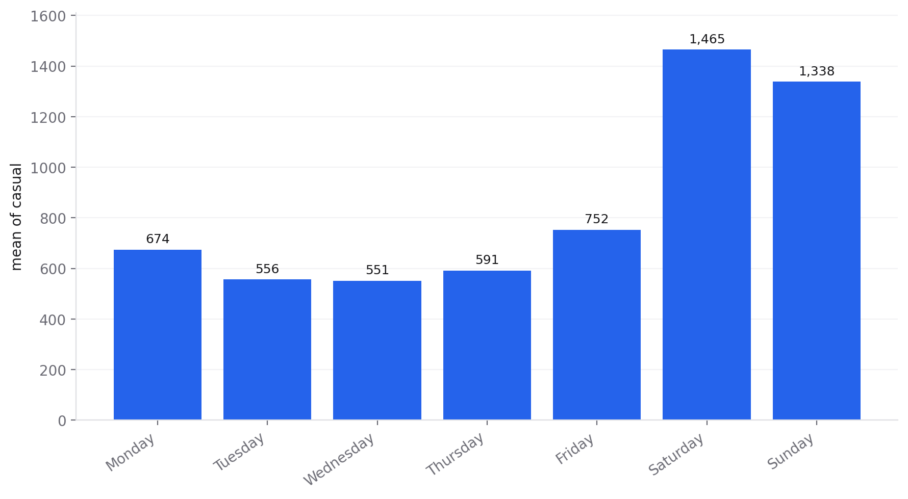
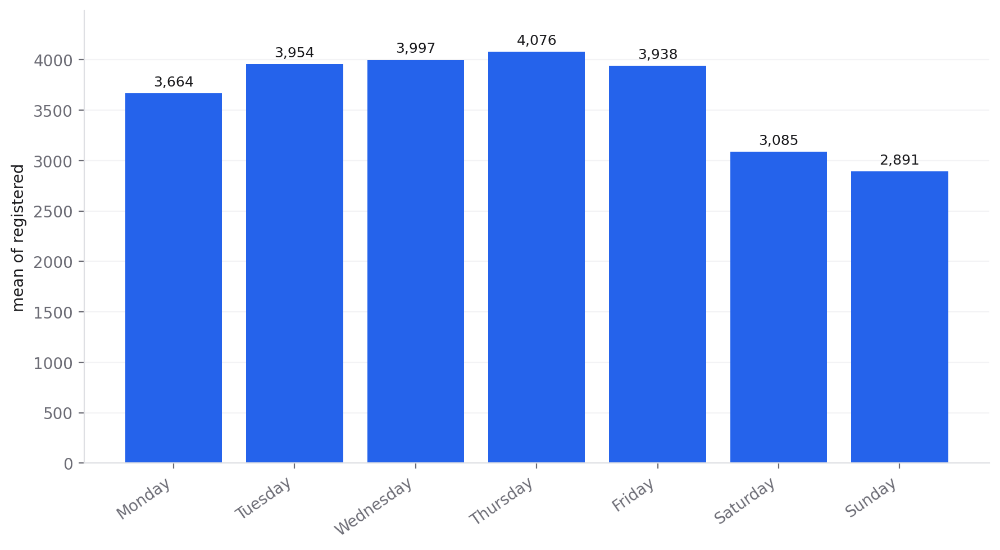
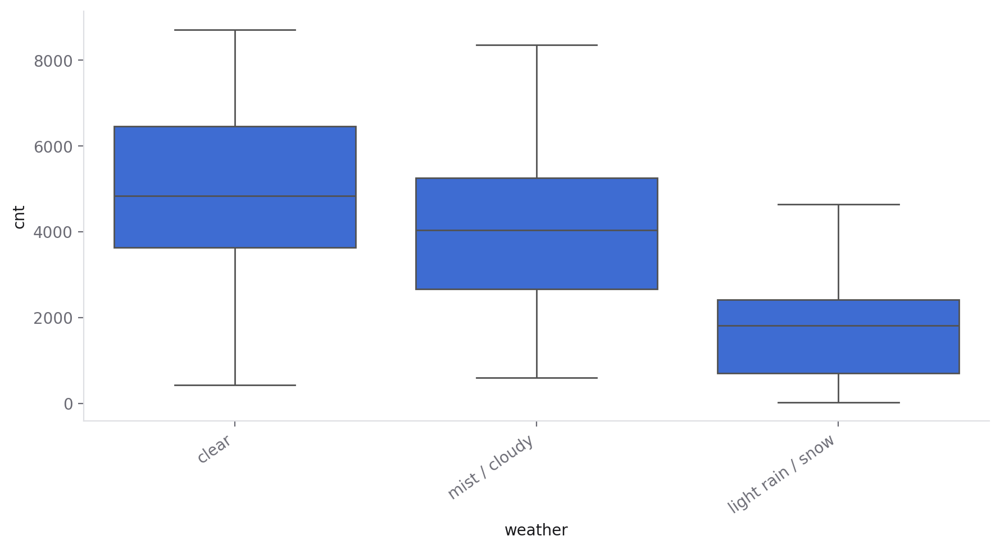
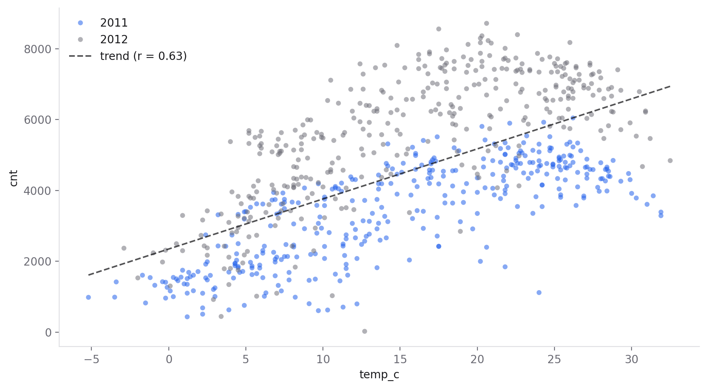
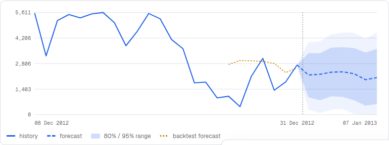
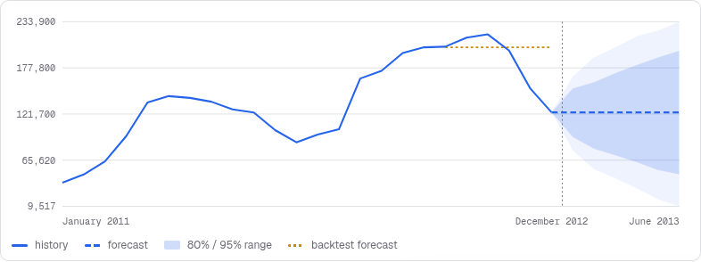

# Two years of Washington bike sharing: trends, rhythms and an honest forecast

*A Data Boss case study: time-series trends, weekday patterns, weather effects and a forecast whose backtest says exactly how far to trust it.*

**Short answer:** rentals grew **65% from 2011 to 2012**, follow a strong **seasonal** cycle (in 2011 the busiest month had 3.8× the rentals of January), and come from **two different kinds of rider**: commuters on working days and leisure riders at weekends. A daily forecast that knows the weekly rhythm beats a naive guess, but **two years of data are not enough to forecast the seasons**. Data Boss says so instead of pretending.

| Files | |
|---|---|
| [`report.pdf`](report.pdf) / [`report.html`](report.html) | The report exported from Data Boss |
| [`bike_sharing_session.ipynb`](bike_sharing_session.ipynb) | The whole session as a Jupyter notebook |
| [`forecast_daily.py`](forecast_daily.py) | The daily forecast and its backtest as a statsmodels script |
| [`data/day.csv`](data/day.csv) | The dataset (731 days), so everything here can be rerun |
| [`figures/`](figures) | Charts exported from Data Boss |

## The data

The [UCI Bike Sharing dataset](https://archive.ics.uci.edu/dataset/275/bike+sharing+dataset): daily rentals from Capital Bikeshare in Washington D.C., 1 January 2011 to 31 December 2012. Rentals are split into **casual** and **registered** riders, with the weather, temperature and working-day flags for each day. Licensed CC BY 4.0. Source: Fanaee-T, H. and Gama, J. (2013), *Event labeling combining ensemble detectors and background knowledge*, Progress in Artificial Intelligence.

## 1. Preparing it in Data Boss

**Inspect** found a clean file (no missing values). Its one important hint: **`dteday` holds dates stored as text**, with a one-click **Convert to date**. The cleaning steps, all exported as code:

- converted `dteday` to dates
- turned the coded weather (1–4) into words with a **Calculated column**: clear, mist / cloudy, light rain / snow
- labelled working days vs weekends and holidays
- restored real temperatures in °C from the dataset's 0–1 scale (`temp × 47 − 8`)
- added the weekday with **Date parts**, which keeps Monday-to-Sunday order in every chart and table
- dropped the codes and normalised columns that were no longer needed

## 2. The trend: strong growth on top of the seasons

**Analyze › Trends** (monthly totals, compared with the same month a year earlier):

- **Growth:** 1.24 million rentals in 2011, **2.05 million in 2012 (+65%)**. Every quarter of 2012 beat the same quarter of 2011, and **2012 Q1 was 142% above 2011 Q1**.
- **Peak and low:** September 2012 had 218,573 rentals; January 2011 had 38,189.
- **Biggest jump:** **March 2012 was 60% above February** (157% above March 2011). It was also a warm March: 13.1 °C on average, against 7.6 °C a year earlier.
- **Winter is still winter:** December 2012 was 19% below November, though still 42% above December 2011.

## 3. Two kinds of rider

 

| Average per day | Monday | Tuesday | Wednesday | Thursday | Friday | Saturday | Sunday |
|---|---|---|---|---|---|---|---|
| Casual | 674 | 556 | 551 | 591 | 752 | **1,465** | **1,338** |
| Registered | 3,664 | 3,954 | 3,997 | **4,076** | 3,938 | 3,085 | 2,891 |

**Analyze › Tests** confirms both patterns clearly:

- **Casual riders:** **765 more per day on weekends and holidays** than on working days (95% CI 646 to 883; Welch's t-test, p < 0.001, a large effect).
- **Registered riders:** **1,019 more per day on working days** (95% CI 803 to 1,236; p < 0.001, a medium effect). That's commuting.

So "rentals per day" mixes two products: a commuter service and a leisure service.

## 4. Weather and temperature

- **Weather:** clear days average **4,877** rentals, misty or cloudy days 4,036, and light rain or snow **1,803**, a 63% drop (one-way ANOVA, p < 0.001).
- **Temperature:** warmer days have clearly more rentals (Pearson r = **+0.63**, 95% CI +0.58 to +0.67), about **141 more rentals per extra °C** on the trend line.
- **The quietest day of all:** **29 October 2012, with 22 rentals**, the day Hurricane Sandy reached Washington.

## 5. Forecasting, and knowing its limits

**Model › Forecast** chooses the exponential-smoothing variant automatically and **backtests** it: it hides the last periods, forecasts them, and compares the error with a naive benchmark.

### Daily: the weekly rhythm is learnable

- **Model:** exponential smoothing with a level and a **weekly seasonal pattern**. Fridays run about 169 rentals above the level and Sundays 266 below.
- **Forecast:** around **2,000–2,350 rentals a day** for the first week of January 2013, 80% range 952 to 3,381 on 1 January.
- **Backtest on the last week of 2012:** off by **1,063 rentals a day on average, about half the error of the naive benchmark** (repeating the same weekday a week earlier: 2,020). The percentage error looks huge (134%) only because that week was **Christmas**, with days as low as 441 rentals.
- **Fix found along the way:** the simulated range first dipped below zero, so Data Boss now cuts ranges off at 0 for counts.

### Monthly: two years are not enough

To learn a yearly season, a model needs **at least two full years plus a little more** (26 months). This dataset has exactly 24. Data Boss **refuses to fake the seasonality** and says so: the monthly forecast is a flat level (about 124,000 a month), and the backtest shows it is **no better than repeating last month**. Any monthly plan from this data should lean on the year-over-year comparisons in section 2, not on this forecast.

## Conclusions

1. **Growth is real and large:** +65% year over year, in every quarter.
2. **Plan for two audiences:** commuters (working days, registered) and leisure riders (weekends, casual) behave differently and respond differently to weather.
3. **Weather and temperature move demand a lot:** rain or snow cuts it by roughly two thirds.
4. **Short-term forecasts are useful, seasonal forecasts need more history:** the daily model beats a naive guess; monthly forecasting needs a third year of data.

## Limitations

- **Two years, one city.** The growth includes the system expanding (new stations, members), which this data can't separate from rising demand.
- **Daily totals only.** Hourly patterns (rush hours) are in the dataset's `hour.csv` and not analysed here.
- **Correlation, not cause.** Temperature and season move together, so their effects overlap.

*Made with [Data Boss](../../README.md). Every number above comes from the exported notebook and scripts in this folder.*
