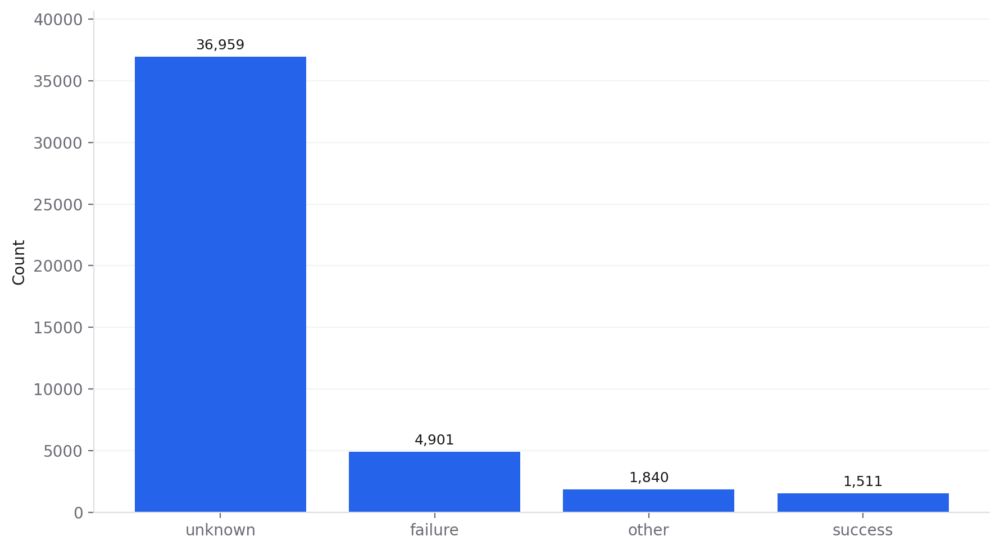
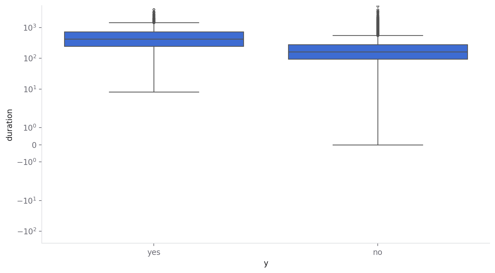
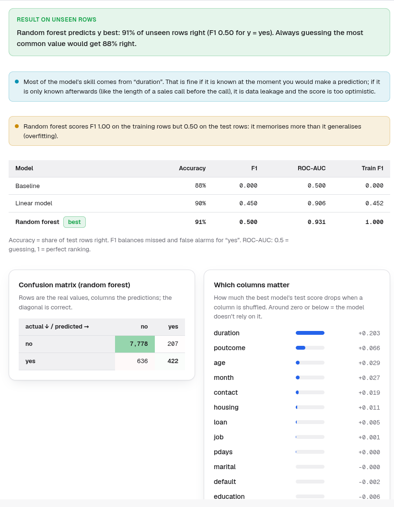
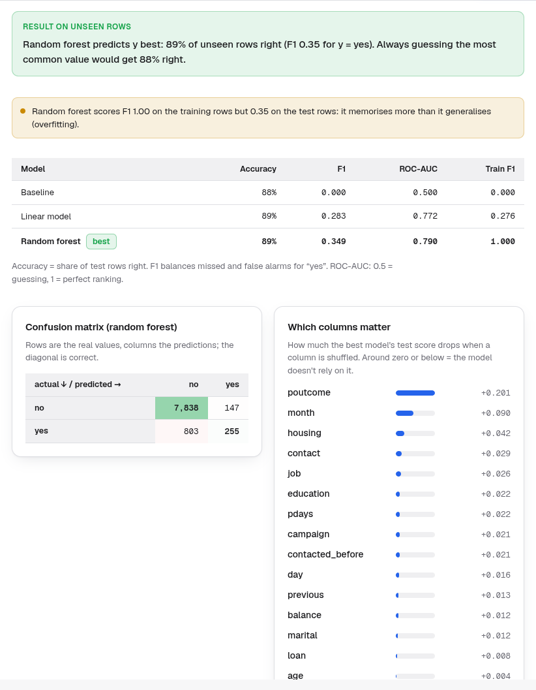

# Who will subscribe? An honest model of a bank's phone campaign

*A Data Boss case study: predicting which customers say yes to a term deposit, comparing three models against a do-nothing baseline, and catching the classic leakage trap.*

**Short answer:** with the column everyone is tempted to use, the call's **duration**, a random forest looks excellent (ROC-AUC **0.93**). But a call's length is only known *after* the call, so that model is useless for deciding **whom to call**. Without it, the honest model reaches ROC-AUC **0.79**. That's genuinely useful for ranking a call list, though at the default threshold it finds only **a quarter of the customers who will say yes**. Accuracy, the number most people quote, barely moves (88% → 89% → 91%), because always guessing "no" already scores 88%.

| Files | |
|---|---|
| [`report.pdf`](report.pdf) / [`report.html`](report.html) | The report exported from Data Boss |
| [`bank_marketing_session.ipynb`](bank_marketing_session.ipynb) | The session as a Jupyter notebook |
| [`model_realistic.py`](model_realistic.py) | The realistic model as a scikit-learn script; it prints the same scores as the app |
| [`data/download.py`](data/download.py) | Downloads the dataset (`bank-full.csv`, 4.6 MB) |
| [`figures/`](figures) | Charts and model results from Data Boss |

## The data

The [UCI Bank Marketing dataset](https://archive.ics.uci.edu/dataset/222/bank+marketing): **45,211 customers** of a Portuguese bank called during direct-marketing campaigns (2008–2010). For each customer it has age, job, marital status, education, balance, loans, contact details, the result of any previous campaign, and the target **`y`: did they subscribe to a term deposit?** Licensed CC BY 4.0. Source: Moro, S., Rita, P. and Cortez, P. (2014), UCI Machine Learning Repository, [doi:10.24432/C5K306](https://doi.org/10.24432/C5K306).

Only **11.7% (5,289) subscribed**. That imbalance shapes everything below.

## 1. Preparing it

Data Boss read the semicolon-separated file automatically, and **Inspect** found no missing values but six heavily skewed number columns. One fix mattered for modelling:

- **`pdays = -1`** means "never contacted before", but as a number it pretends to be a very short gap. I added a `contacted_before` yes/no column and turned the −1 into missing, so models don't learn from a fake number.

## 2. What goes with saying yes?

**Inspect › Target** and **Analyze › Tests** on `y`:

| Customer group | Calls | Subscribed |
|---|---|---|
| Previous campaign **succeeded** | 1,511 | **64.7%** |
| Previous campaign failed | 4,901 | 12.6% |
| Never contacted before | 36,954 | 9.2% |
| Called in **May** (the busiest month) | 13,766 | **6.7%** |
| Called in March / September / October / December | 2,008 in total | **44–52%** |
| Contact by mobile | 29,285 | 14.9% |
| Contact type unknown | 13,020 | 4.1% |

- **The strongest real signal is the previous outcome:** customers who said yes before mostly say yes again (chi-square p < 0.001, Cramér's V 0.31).
- **Timing matters:** the busiest month, May, has the worst conversion, and the quiet months convert at seven times the rate. Some of this is who gets called when, not the month itself.

## 3. The trap: call duration

Customers who subscribed had much longer calls (median **426 seconds vs 164**; Mann-Whitney p < 0.001, a large effect). Of course they did: a customer who says yes stays on the line to sign up. **The duration is a consequence of the outcome, known only when the call ends.** The dataset's documentation (`bank-additional-names.txt`) says it "should only be included for benchmark purposes and should be discarded if the intention is to have a realistic predictive model."

### Model A: with duration (looks great, can't be used)

| Model | Accuracy | F1 (yes) | ROC-AUC |
|---|---|---|---|
| Baseline (always "no") | 88.3% | 0.00 | 0.50 |
| Logistic regression | 90.1% | 0.45 | 0.91 |
| **Random forest** | **90.7%** | **0.50** | **0.93** |

**How Data Boss handled it:** its near-perfect-score check *didn't* fire, because 0.93 is very good but not suspicious. This case study exposed that gap, so I added a check ([commit 3c29d94](https://github.com/49mg/data-boss/commit/3c29d94)). When one column carries most of a model's skill, Data Boss now reminds you to make sure it's known *before* the moment you predict. Here it names `duration`, which carries three times the importance of anything else. A tool can measure dominance; only the analyst can know *when* a value becomes available.

### Model B: realistic (only what's known before calling)

| Model | Accuracy | F1 (yes) | ROC-AUC |
|---|---|---|---|
| Baseline (always "no") | 88.3% | 0.00 | 0.50 |
| Logistic regression | 89.4% | 0.28 | 0.77 |
| **Random forest** | **89.5%** | **0.35** | **0.79** |

- **What the score means:** ROC-AUC 0.79 says the model ranks a random future subscriber above a random non-subscriber **79% of the time**. Calling customers in score order finds subscribers far faster than calling at random.
- **The limit at the default 0.5 threshold:** on the 9,043 test customers, it flags 402 as likely subscribers, and **255 of them really subscribe** (63% precision, against an 11.7% base rate). But it **misses 803 of the 1,058** who do subscribe (24% recall).
- **What drives it:** the previous campaign's outcome (by far), the month, whether the customer has a housing loan, the contact type and the job. All of these are known before dialling.
- **Overfitting:** Data Boss flags that the random forest scores F1 1.00 on its training rows against 0.35 on unseen ones. It memorises individual customers. It still beats the logistic model on unseen data, so it's the better choice here, but a tuned forest (shallower trees) would generalise better.

## Conclusions

1. **Always ask "when would I know this?"** The most predictive column was unusable. Leaving it out drops ROC-AUC from 0.93 to 0.79, and that's the honest number.
2. **Don't judge an imbalanced problem by accuracy.** All three models score 88–91%; F1 and ROC-AUC show the real differences.
3. **The useful product is a ranking, not a yes/no.** A call list sorted by score, starting with previous successes and the better months, beats calling everyone.
4. **Some patterns are campaign design, not customer behaviour.** May's poor rate is likely about whom the bank called that month.

## Limitations

- **One bank, 2008–2010.** The campaigns ran through the financial crisis, so conversion patterns may not transfer.
- **No tuning:** Data Boss deliberately compares simple default models. A tuned gradient-boosting model would likely add a few points of ROC-AUC.
- **The threshold is a business decision:** 0.5 is arbitrary. The right cut-off depends on the cost of a call versus the value of a deposit.
- **Associations, not causes:** calling in March won't by itself make customers subscribe.

*Made with [Data Boss](../../README.md). The scores above come from the app and are reproduced exactly by [`model_realistic.py`](model_realistic.py).*
